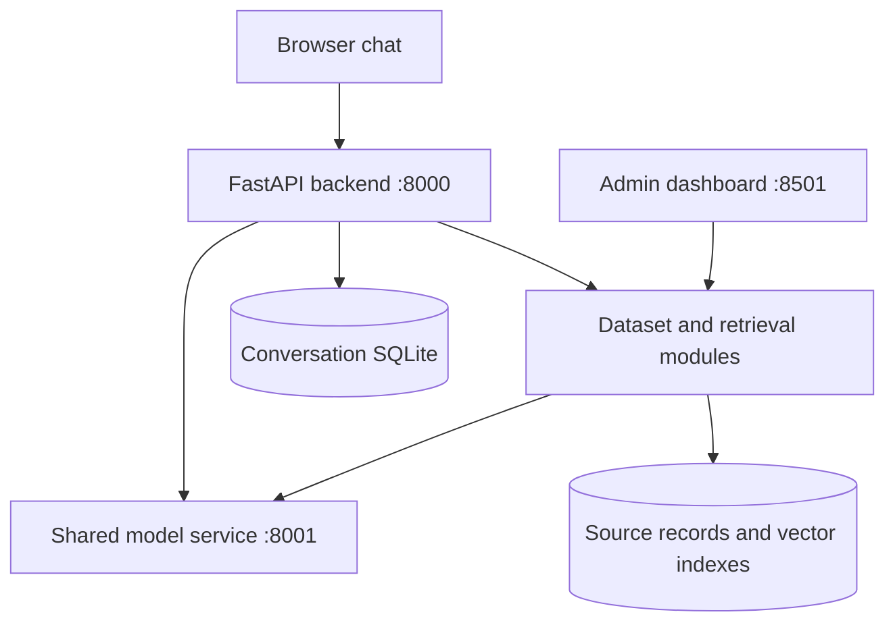

# Legal LLM

**A Vietnamese AI assistant for your own datasets.**

Ask about administrative procedures, university services or other structured information. Get streamed answers with source records you can inspect, and manage your datasets through a web dashboard.

[Features](#features) · [Quick start](#quick-start) · [Models](#models-and-stack) · [Documentation](#documentation) · [Team](#team)


<!-- Replace with an actual screenshot of a completed answer and its expanded source record. -->

## Features

- **Answers with sources.** Inspect the records used to answer a question, including available fees, requirements, conditions and locations.
- **Multiple datasets.** Use the same chat interface for different domains. Automatic routing selects a dataset, or you can choose one yourself.
- **Conversation context.** Ask follow-up questions without repeating the service name. Control whether a conversation can switch topics or stays in one domain.
- **Local AI inference.** Run Qwen locally, with GPU acceleration for generation, embedding and reranking.
- **Dataset management.** Upload Excel, CSV, TSV, JSON or JSONL files. Review field mappings and configure how each dataset is searched and presented.
- **Versioned ingestion.** Track ingestion progress, inspect dataset generations and roll back to an earlier version.
- **Chat history and feedback.** Reopen conversations and flag answers that need improvement.
- **Forms and external search.** Offer configured procedure forms and optionally use MCP search through the permission flow.
- **Diagnostics.** Review service logs, request timings and exported test conversations when investigating a problem.


<!-- Replace with an actual screenshot of dataset configuration or ingestion progress. -->

## Quick start

For Windows, install [Python 3.12](https://www.python.org/downloads/release/python-31210/)
with the Python launcher, [Docker Desktop](https://docs.docker.com/desktop/setup/install/windows-install/)
and your GPU driver. Start Docker Desktop using Linux containers.

### 1. Download the project

[Download ZIP](https://github.com/h-nam-sys/Legal_LLM/archive/refs/heads/main.zip)
and extract it, or clone the repository with GitHub Desktop.

### 2. Add the model and demo files

| Download | Save / extract to |
|---|---|
| [Qwen3.5-4B IQ4_XS](https://huggingface.co/bartowski/Qwen_Qwen3.5-4B-GGUF/resolve/main/Qwen3.5-4B-IQ4_XS.gguf?download=true) | `models/qwen3.5_4b.gguf` — rename the downloaded file |
| **Prepared retrieval models + demo data: [GOOGLE DRIVE LINK TO ADD]** | Project root — keep the archive's folder structure |

The prepared bundle supplies `models/rag_directml/`, `data/` and optional
`backend/static/forms/`. It is required for this ready-to-run setup. To prepare
models and ingest your own data instead, see [setup](docs/SETUP.md#full-source-installation).

### 3. Create `.env`

Create a file named `.env` beside `start_all_services.bat` and paste:

```dotenv
LLM_SERVICE_URLS=http://localhost:8001
LOG_LEVEL=INFO
CHAT_MODE=strict

RAG_PREPARE_QUERY=1
RAG_CANDIDATE_K=20
RAG_RESULT_K=5
RAG_EXACT_FIELD_OUTPUT=1

RAG_ANSWER_GUIDANCE=1
RAG_LOW_SCORE_RECOVERY=0

GEMINI_API_KEY=
APP_ENV=production
PUBLIC_HOST=
SESSION_COOKIE_SECURE=auto

ADMIN_PASSWORD=change-this-password
```

Choose an admin password. `GEMINI_API_KEY` is optional and enables AI-assisted
dataset profile proposals. Leave the domain/cookie settings above for localhost;
HTTPS configuration is covered in [setup](docs/SETUP.md). If `backend/.env`
already exists, keep its settings consistent with this file.

### 4. Start

Open PowerShell in the project folder and run:

```powershell
.\start_all_services.bat --docker
```

The first launch downloads the [Docker image](https://hub.docker.com/r/namnhedu/legal_llm-chat-service)
(`hybrid-v1`) and installs missing Windows inference packages. Later launches reuse
them. Docker runs backend/admin; model inference runs on Windows. Keep internet
access available during first startup for package and tokenizer downloads.

Chat opens automatically when ready:

| Interface | Address |
|---|---|
| Chat | <http://localhost:8000/chat> |
| Admin | <http://localhost:8501> |
| API docs | <http://localhost:8000/docs> |

Keep the terminal open. Press **Ctrl+C** to stop.

**Release availability:** the Drive link above still needs to be added, and the
maintainer must publish `namnhedu/legal_llm-chat-service:hybrid-v1` before others
can use this Docker setup. [Publishing instructions](deployment/container/README.md#publish-from-the-working-development-machine).

<details>
<summary>Run without Docker</summary>

Use the same model/data files and `.env`. In Command Prompt at the project root:

```bat
py -3.12 -m venv env
env\Scripts\activate.bat
python -m pip install -r requirements.txt
start_all_services.bat
```

This installs and runs all services directly on Windows. Docker and native modes
use separate data stores after Docker's first import; see [setup](docs/SETUP.md).

</details>

## Usage

Open the chat page and select automatic routing or a specific dataset. No login is required. A persistent browser cookie grants access to your chat history; clearing it or switching browsers starts a separate history. Enable topic switching when you want to move between datasets in one conversation.

With the corresponding demo datasets loaded, try:

```text
Đăng ký khai sinh mất bao lâu và lệ phí bao nhiêu?
```

```text
Ở thư viện Demo, mỗi lần được mượn mấy cuốn và trong bao lâu?
```

Expand the source record beneath an answer to inspect its evidence. Use the admin dashboard to add your own data or adjust a dataset’s configuration.


Conversation across datasets (with automatic domain switching):


<!-- Replace with an actual conversation showing two datasets, with switching enabled. -->


## Models and stack

| Component | Technology |
|---|---|
| Language model | Qwen3.5-4B, IQ4_XS GGUF; 4,096-token application context |
| Generation runtime | llama-cpp-python with Vulkan |
| Embeddings | [BAAI/bge-m3](https://huggingface.co/BAAI/bge-m3) |
| Reranker | [BAAI/bge-reranker-v2-m3](https://huggingface.co/BAAI/bge-reranker-v2-m3) |
| Retrieval runtime | LlamaIndex, ONNX Runtime and DirectML |
| Backend / admin | FastAPI / Streamlit |
| Storage | SQLite and persisted vector indexes |
| Optional integrations | Gemini for dataset-profile proposals; MCP for external search |

## Architecture



The backend selects a dataset, resolves conversational references and retrieves relevant records. The shared model service provides generation, embeddings and reranking. Responses and their sources are saved with the conversation.

## Documentation

- [Installation, model preparation and ingestion](docs/SETUP.md)
- [Admin settings and workflows](docs/ADMIN.md)
- [Docker image sharing and storage](deployment/container/README.md)
- [Backend API](backend/spec.md)
- [Issues and bug reports](https://github.com/h-nam-sys/Legal_LLM/issues)

Development history and individual contributions are recorded in the existing repository. Application regression checks and research evaluation are maintained separately.

## Team

**Team:** `Team 10`

| Member | GitHub | Responsibilities |
|---|---|---|
| Nguyen Hai Nam | [@h-nam-sys](https://github.com/h-nam-sys) | System architecture, backend development, RAG integration and refinement, task coordination, experiment review and system debugging. |
| Nguyen Minh Thinh | [@minhthinhn](https://github.com/minhthinhn) | Development of the initial working RAG module; ongoing research and paper development. |
| Le Thien Khang | [@thienkhang1234](https://github.com/thienkhang1234) | Model selection, fine-tuning and quantization experiments, AI evaluation; ongoing research and paper development. |

Contributions and development history are available in the [commit history](https://github.com/h-nam-sys/Legal_LLM/commits) and [pull requests](https://github.com/h-nam-sys/Legal_LLM/pulls).

## License

Project code is distributed under the [MIT License](LICENSE). Model weights and dependencies retain their respective upstream licenses.
